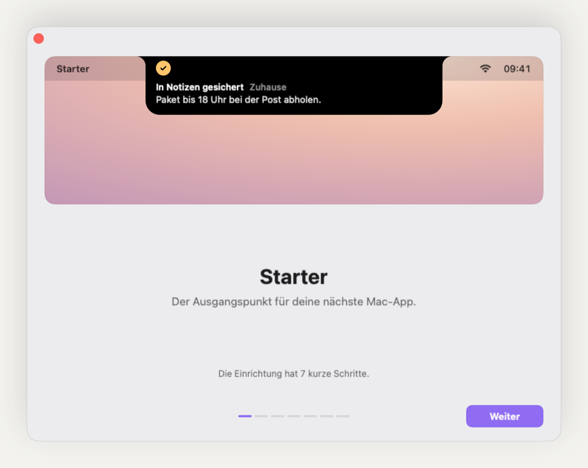

# Mac-App-Starter

Vorlage, aus der jede neue native Mac-App startet, auch eine fachlich völlig andere. Ein Agent baut ab dem ersten Auftrag Funktionen und muss Fenster, Einstellungen, Onboarding, Gestaltung, Sprachen und Verteilung nicht neu bauen. Gebaut wird ohne Xcode, mit den Command Line Tools allein.


Fertig verdrahtet sind:

- vier App-Formen, frei kombinierbar: Fenster-App im Stil von Musik unter macOS 26, Menüleisten-App mit Statussymbol und Panel, Insel an der Notch (Kapsel auf Macs ohne Notch), Hintergrund mit geplanten Aufgaben und Start beim Anmelden
- Gestaltung im Stil von VoiceBud: Tokens für Farben, Abstände, Radien, Schrift und Bewegung, sechs Akzente mit geprüften Kontrasten, Bausteine und Muster für Einstellungen und Onboarding, hell und dunkel
- Onboarding mit Sprache, Funktionen, Berechtigungen (mit allen Zuständen bis zum Neustart) und Abschluss
- Einstellungsfenster wie die Systemeinstellungen, mit „Allgemein“, „Über“ und einer Galerie aller Bausteine
- Englisch und Deutsch mit Wechsel ohne Neustart, deutsche Anrede einstellbar
- globale Kurzbefehle mit Regeln gegen belegte und tippende Kombinationen
- lokale KI mit Apple Foundation Models, optional eigene Modelle über MLX mit Download und Fortschritt
- Einstellungen als JSON, SQLite mit Migrationen, keine Netzaufrufe ohne Auftrag
- Renders jeder Szene in beiden Sprachen und Erscheinungsbildern ohne Fenster, Selbsttest, Tests ohne XCTest
- programmatisches App-Symbol, DMG mit gestaltetem Fenster, Signatur ad hoc oder mit Developer ID, Notarisierung
- Regeln für Agenten, die Prüfskripte, Hooks, Subagenten und CI erzwingen

| | |
|---|---|
|  |  |
|  |  |

<!-- nur-im-starter:anfang -->
## Stand

Fassung 1.0.0 im Bau, die Änderungen stehen in `CHANGELOG.md`. Bauplan, Strang-Plan und Statusberichte liegen während des Baus unter `docs/bau/`; `bin/starter init` entfernt sie in einem Projekt. Ein neues Projekt richtet sich nach `docs/UEBERGABE.md`.
<!-- nur-im-starter:ende -->

## Ein neues Projekt starten

Schritt für Schritt in `docs/UEBERGABE.md`. Kurz:

1. Auf GitHub beim Repository `mac-app-starter` „Use this template“ wählen, privat anlegen und auf einem Mac mit Apple Silicon und macOS 26 klonen.
2. `make doctor` prüft die Werkzeuge (Command Line Tools genügen) und installiert nichts.
3. `bin/starter init` legt Name, Bundle-ID, Akzent und Symbol fest, entfernt die Bauunterlagen des Starters und leert die Commit-Identität; danach die eigene Identität in `starter.json` eintragen und `make hooks`.
4. Nicht benötigte Module mit `bin/starter remove <modul>` entfernen, `docs/PROJECT.md` füllen.
5. `make check`, `make shots`, dann `make run` und das Onboarding einmal selbst durchgehen.
6. Einen Agenten mit dem Prompt unten starten und die Renders der ersten Stufe ansehen; Rückmeldungen kommen in `docs/agents/VORGABEN.md`.

### Bootstrap-Prompt

```
Neues Projekt auf Basis von mac-app-starter.
Projekt: <Name>. Zweck: <ein bis zwei Sätze>. Zielgruppe: <wer, welches Vorwissen>.
App-Formen: <Fenster, Menüleiste, Insel, Hintergrund>. Hauptansichten: <drei bis fünf>. Daten: <z. B. Notiz, Projekt>.
Berechtigungen: <keine, Mitteilungen, Mikrofon …>. Lokale KI: <nein oder wofür>. Sprachen: Englisch und Deutsch, Anrede <du oder Sie>.

1. CLAUDE.md, docs/DESIGN.md, docs/ARCHITEKTUR.md und docs/agents/VORGABEN.md lesen.
2. make doctor und make check ausführen; make shots und die Szenen in build/shots ansehen.
3. starter.json, App/Resources/InfoPlist.json und docs/PROJECT.md füllen. Akzent nur aus der Palette in docs/DESIGN.md.
4. In docs/agents/PLAN.md Stufen und Stränge planen und die Datei-Zuständigkeit in docs/agents/straenge.json eintragen. Nicht benötigte Module mit bin/starter remove <modul> entfernen, je Modul ein Commit.
5. Jedes Feature mit dem Skill neues-feature bauen, Ansichten mit neue-ansicht, neue-einstellung und neuer-onboarding-schritt. Sobald das erste eigene Feature steht, bin/starter strip-examples ausführen.
6. Nicht ändern: Kit-Pfade aus starter.manifest.json und Teil A von CLAUDE.md. Eigene Regeln kommen nach rules/projekt/. Bedarf am Kit in docs/STARTER_FEEDBACK.md festhalten.
7. Die App nie selbst starten, keine Berechtigung anfragen: prüfen mit make test, make shots und --selftest. Jede Szene in en und de, hell und dunkel ansehen. Vor jedem Push make check. Jede Stufe mit dem Skill red-team prüfen lassen.
8. Eigener Branch, kleine Commits, mindestens stündlich pushen, nie auf main. Offene Fragen an den Auftraggeber in docs/PROJECT.md sammeln statt raten.
```

### Wann ein Projekt fertig ist

- `make check` ist grün, die CI ebenso (Build-Matrix der genutzten Module, Tests, Renders).
- Jede genutzte App-Form ist in Renders angesehen: jede Szene in en und de, hell und dunkel.
- Das Onboarding ist einmal auf einem frischen Benutzer durchgegangen (`tccutil reset All <bundleId>` setzt nur diese App zurück).
- Jede Berechtigung ist mit der installierten App aus dem DMG erteilt, abgelehnt und nach einem Neustart erkannt worden.
- Die Insel ist an einem Mac mit und einem ohne Notch geprüft, falls sie genutzt wird.
- Das DMG öffnet mit gestaltetem Fenster und installiert auf einem zweiten Mac oder Benutzer; bei Developer ID bestehen `codesign --verify --deep --strict`, `spctl -a -vv` und `xcrun stapler validate`.
- Das App-Symbol ist ein eigenes Motiv, kein SF Symbol.
- Es gibt keine Reste der Beispiele mehr.
- `docs/PROJECT.md` ist gefüllt, Zugangsdaten liegen nur im Schlüsselbund oder in den Geheimnissen der CI.

## Aufbau

| Pfad | Inhalt |
|---|---|
| `CLAUDE.md` | Teil A: allgemeine Regeln, erzeugt aus `rules/`; Teil B: Verweis auf das Projekt |
| `rules/` | einzige Regelquelle: Regelgruppen, Wortlisten; `rules/projekt/` für die Regeln des Projekts |
| `starter.json` | die eine Konfiguration: Name, Bundle-ID, Akzent, Symbol, Module, Berechtigungen, Sprachen, Commit-Identität, Signatur |
| `starter.manifest.json` | Kit-, gemeinsame und Projekt-Pfade, Module mit ihren Pfaden und Abhängigkeiten |
| `starter.lock.json` | Starter-Fassung und Prüfsummen der Kit-Dateien eines Projekts |
| `App/Sources/Kit/` | immer dabei: Sprache, Einstellungen, Datenbank, Registry, Design, Onboarding, Einstellungsfenster, Berechtigungen, Galerie, Render, Start |
| `App/Sources/Modules/` | entfernbare Module, je Ordner eines |
| `App/Sources/Features/` | Funktionen des Projekts |
| `App/Resources/` | Erklärtexte der Berechtigungen (`InfoPlist.json`), App-Symbol |
| `App/Tests/` | Swift-Tests mit eigenem Harness |
| `ai-worker/` | Python-Worker für MLX (Modul `mlx`) |
| `tools/` | App-Symbol und DMG-Hintergrund in Swift, Einstellungen für dmgbuild |
| `scripts/` | Build, Tests, Renders, Prüfungen, Hooks, Starter-Werkzeuge |
| `bin/starter` | init, remove, strip-examples, sync, check-kit, modules |
| `docs/` | `UEBERGABE.md`, `DESIGN.md`, `ARCHITEKTUR.md`, `MODULE.md`, `KI.md`, `VERTEILUNG.md`, `PROJECT.md`, `DECISIONS.md`, `STARTER_FEEDBACK.md`, `agents/`, `vorlagen/` |
| `.claude/` | Rechte, Hooks, Skills, Subagenten, Workflow `red-team` |

## Regeln

Die Regeln stehen einmal in `rules/` und werden mit `make rules` verteilt: nach `CLAUDE.md` Teil A und in die Wortlisten der Prüfskripte. `make check` prüft Regeln, Texte in beiden Sprachen, Design-Tokens und Kit-Pfade; der Hook `commit-msg` prüft Autor und Format jedes Commits. Neue Wünsche kommen in `docs/agents/VORGABEN.md` und werden innerhalb eines Arbeitstags in `rules/projekt/` eingearbeitet. Bei Widerspruch gilt: `docs/agents/VORGABEN.md` vor `CLAUDE.md` vor `docs/PROJECT.md` vor `docs/DESIGN.md`.

## Module

| Modul | Inhalt | Standard | Entfernen |
|---|---|---|---|
| `window` | Hauptfenster mit Seitenleiste, Suche und Bausteinen im Stil von Musik | an | `bin/starter remove window` |
| `menubar` | Statussymbol mit Zuständen, Panel, Menü; ohne `window` ohne Dock-Symbol | an | `bin/starter remove menubar` |
| `island` | Insel an der Notch, Kapsel ohne Notch, alle Zustände bis zur Ergebniskarte | an | `bin/starter remove island` |
| `background` | geplante Aufgaben, Start beim Anmelden | an | `bin/starter remove background` |
| `hotkeys` | globale Kurzbefehle mit Aufnahme und Regeln | an | `bin/starter remove hotkeys` |
| `ai` | lokale KI mit Apple Foundation Models | an | `bin/starter remove ai` |
| `mlx` | eigene Modelle über MLX, Downloads mit Fortschritt (braucht `ai`) | aus | `bin/starter remove mlx` |
| `examples` | Beispiel-Feature, das alle Module nutzt | an | `bin/starter strip-examples` |

Mindestens `window` oder `menubar` bleibt. Einzelheiten je Modul in `docs/MODULE.md`.

## Befehle

| Befehl | Zweck |
|---|---|
| `make doctor` | Werkzeuge prüfen (Command Line Tools, Compiler, SDK, Python), installiert nichts |
| `make build` | Debug-Build nach `build/<Name>.app`; `MODULES=a,b` wählt andere Module, `CONFIG=release` optimiert |
| `make run` | bauen und die App starten |
| `make test` | Swift-Tests (`build/tests/run-tests`) und Python-Tests; `ONLY=<präfix>` wählt aus |
| `make check` | Regeln, Texte, Design, Kit, Build und Tests; vor jedem Push |
| `make shots` | jede Szene in en und de, hell und dunkel nach `build/shots/` mit `index.html`; `ONLY=<präfix>` |
| `make readme-shots` | Bilder aus `docs/screenshots/list.txt` nach `docs/screenshots/` kopieren |
| `make icon` | App-Symbol aus Akzent und Symbol nach `App/Resources/AppIcon.icns` |
| `make dmg` | Release-Build und DMG nach `build/dmg/` |
| `make notarize` | mit Developer ID signieren und notarisieren |
| `make rules` | `CLAUDE.md` Teil A und Wortlisten aus `rules/` schreiben |
| `make hooks` | `scripts/hooks` als Git-Hooks einrichten |
| `bin/starter init` | eine Kopie des Starters zum Projekt machen |
| `bin/starter remove <modul> [--probelauf] [--ohne-build]` | ein Modul mit seinen Dateien und Markierungen entfernen |
| `bin/starter strip-examples` | die Beispiele entfernen |
| `bin/starter sync --ziel <tag> [--probelauf]` | Kit-Pfade auf eine neuere Fassung des Starters ziehen |
| `bin/starter modules` | Module mit Stand und Pfaden zeigen |

## Betrieb

Die App läuft auf Apple Silicon ab macOS 26. Standard ist die Ad-hoc-Signatur: Empfänger öffnen die App beim ersten Mal über „Trotzdem öffnen“ in den Systemeinstellungen unter „Datenschutz & Sicherheit“, und jeder neue Build verliert erteilte Berechtigungen. Mit `signing.identity` in `starter.json` signiert der Build mit Developer ID und Hardened Runtime; `make notarize` notarisiert mit einem Profil aus dem Schlüsselbund. Das Anmeldeobjekt funktioniert nur aus einem installierten Ort wie `/Programme`. Einzelheiten in `docs/VERTEILUNG.md`.

## Pflege

Der Starter trägt Tags (`v1.0.0`) und `CHANGELOG.md` mit Inhalt, Migrationen und Hinweisen je Fassung; jedes Projekt speichert seinen Stand in `starter.lock.json`. `bin/starter sync --ziel <tag>` zieht Kit-Pfade per Drei-Wege-Zusammenführung nach, `make check-kit` meldet geänderte Kit-Pfade. Allgemeine Verbesserungen aus Projekten stehen dort in `docs/STARTER_FEEDBACK.md`; der Skill `starter-rueckfluss` macht daraus einen Pull Request im Starter.

Gestaltung und Teile des Codes stammen aus VoiceBud (MIT); die Hinweise stehen in `THIRD_PARTY_NOTICES.md`.
